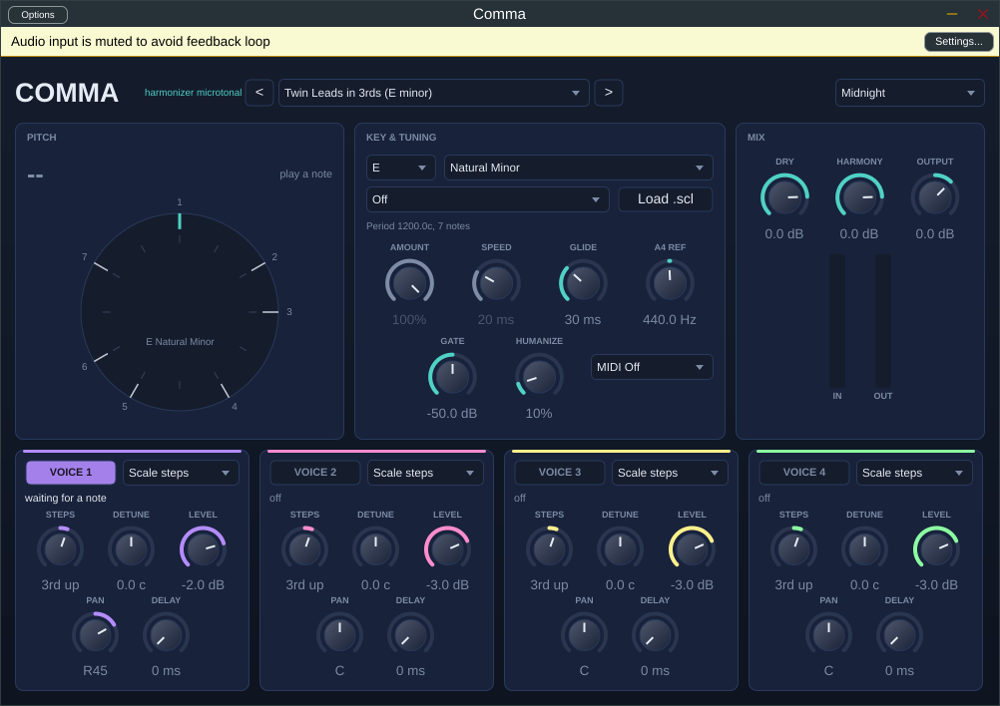

# Comma (working name)

A guitar harmonizer and microtonal tuning simulator (VST3 + standalone). Up to four
harmony voices that follow your key and scale, plus retuning that makes a normal
12-TET guitar play just intonation, quarter tones, maqam scales, 19/31-EDO or any
Scala `.scl` tuning. MIDI input can set the key or play the harmony notes. See `docs/DESIGN.md`.



## Build

```
cmake -B build -DCMAKE_BUILD_TYPE=Release            # fetches JUCE 8.0.4
# or: cmake -B build -DJUCE_DIR=/path/to/JUCE
cmake --build build --config Release
ctest --test-dir build                                # engine tests
```

macOS builds target macOS 11+ universal (Intel + Apple Silicon). No AVX2 or other
`-march` flags are used; the DSP is scalar C++. Windows builds use the static runtime.

Layout: `Source/engine` is plain C++ (pitch tracker, pitch shifter, scales and Scala
parser, harmony logic, presets) with tests in `tests/`. `Source/plugin` is the JUCE
wrapper, UI and themes.
